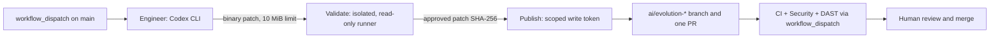

[🇧🇷 Português](ai-first-operations.md)

# Secure AI-First agent operations

### Ubuntu runner update — October 11, 2026

[Issue #31](https://github.com/WillianZanutoOliveira/distributed-commerce-platform/issues/31) correctly triggered [AI Evolution Harness #38153271880](https://github.com/WillianZanutoOliveira/distributed-commerce-platform/actions/runs/38153271880), but Codex's Landlock preflight failed with `filesystem-restricted execution requires bubblewrap to isolate app-server sockets`. The `engineer` job ended before running the agent, showing that the isolated Landlock alternative from PR #30 is not viable on this runner.

The next governance fix **returns to the default Bubblewrap sandbox**, installs distribution packages `bubblewrap`, `apparmor-profiles`, and `apparmor-utils`, loads the Ubuntu-specific `bwrap-userns-restrict` AppArmor profile following official documentation, and runs a sandboxed read preflight before model inference. It **does not** change the host-wide `kernel.apparmor_restrict_unprivileged_userns` setting, disable the sandbox, grant full shell access, or expand `GITHUB_TOKEN` privileges. It fails closed if the profile is unavailable or the sandbox fails. A real post-merge `main` smoke run is required.

### Linux sandbox smoke — October 11, 2026

After API quota was restored, the maintainer reran [AI Evolution Harness run #38134885086](https://github.com/WillianZanutoOliveira/distributed-commerce-platform/actions/runs/38134885086). Codex authenticated and received the task but produced no file changes because sandboxed commands failed on the Ubuntu runner with `bwrap: loopback: Failed RTM_NEWADDR: Operation not permitted`. The `engineer` job failed in `Export a patch` (empty patch) and the dependent `validate` and `publish` jobs were skipped.

This governance fix explicitly enables Codex's alternative **Landlock** Linux sandbox backend (`--enable use_legacy_landlock`) and runs a sandboxed shell *preflight* before starting model inference. It **does not** replace `workspace-write` with `danger-full-access`, expand GitHub privileges, or auto-merge. The alternative backend must pass a real runner smoke test before declaring the full cycle operational.

### Additional authentication finding — October 11, 2026

After merging [PR #26](https://github.com/WillianZanutoOliveira/distributed-commerce-platform/pull/26), [issue #27](https://github.com/WillianZanutoOliveira/distributed-commerce-platform/issues/27) started [harness run #38134291188](https://github.com/WillianZanutoOliveira/distributed-commerce-platform/actions/runs/38134291188). The CLI accepted the options and started in the `workspace-write` sandbox, but received **HTTP 401 / `Missing bearer or basic authentication in header`**. No patch was generated; `validate` and `publish` were skipped. The observed cause is that setting `OPENAI_API_KEY` as an environment variable did not log in the pinned Codex CLI. This governance change uses `codex login --with-api-key` with the secret supplied via **stdin** in a temporary auth directory, without printing the value to logs or committing it; only the `engineer` job receives the secret. Temporary authentication is deleted at the end of the job. A new end-to-end smoke run remains required after human-reviewed governance merge.

## Operational update — October 11, 2026

[PR #24](https://github.com/WillianZanutoOliveira/distributed-commerce-platform/pull/24) merged the issue-trigger bridge to `main` (commit `fcd8479cc0d2047d08b35e58d5676bc7a579cae0`). [Issue #25](https://github.com/WillianZanutoOliveira/distributed-commerce-platform/issues/25), created by the ChatGPT GitHub connector, successfully triggered [bridge run #38133025576](https://github.com/WillianZanutoOliveira/distributed-commerce-platform/actions/runs/38133025576), which dispatched [AI Evolution Harness run #38133032767](https://github.com/WillianZanutoOliveira/distributed-commerce-platform/actions/runs/38133032767).

The first attempt failed because `OPENAI_API_KEY` was missing. **After the repository owner configured the secret**, the rerun passed `Require OpenAI API credential` and installed Codex, but `engineer` failed at `codex exec --full-auto`: pinned `@openai/codex@0.160.0` returned `unexpected argument '--full-auto' found`. Dependent `validate` and `publish` jobs were skipped. This governance patch moves the approval option before `exec` (`codex --ask-for-approval never exec --sandbox workspace-write`) and adds a CLI compatibility check ahead of the agent. It preserves the workspace-write sandbox, removes persisted Git credentials, and never automatically merges.

**Current state:** bridge and API secret verified; end-to-end completion remains contingent on approving and merging the fix, followed by a fresh `main` run proving `engineer → validate → publish`, review-only PR publication and independent green CI/Security/DAST.

## Earlier deployment status — October 10, 2026

**Workflow installed on `main`; end-to-end execution not yet confirmed.** The maintainer merged [PR #17](https://github.com/WillianZanutoOliveira/distributed-commerce-platform/pull/17), [PR #18](https://github.com/WillianZanutoOliveira/distributed-commerce-platform/pull/18), and [PR #19](https://github.com/WillianZanutoOliveira/distributed-commerce-platform/pull/19). The active workflow is [.github/workflows/ai-evolution.yml](../.github/workflows/ai-evolution.yml), present on `main` since commit `d5f76b272d3b02826bd7b16eb4d032412bc5a015`.

PR #19 passed [CI](https://github.com/WillianZanutoOliveira/distributed-commerce-platform/actions/runs/38084752616) and [Security](https://github.com/WillianZanutoOliveira/distributed-commerce-platform/actions/runs/38084752611). This validates the governance change through PR checks; **it does not prove Codex has run, secrets are configured, or automated PR publication works**. As of the October 10, 2026 check, no successful `AI Evolution Harness` run was confirmed. [Issue #15](https://github.com/WillianZanutoOliveira/distributed-commerce-platform/issues/15) remains open until an end-to-end smoke test succeeds.

## Workflow architecture



| Job | Permissions and responsibilities |
| --- | --- |
| `engineer` | `contents: read`, no persisted GitHub credentials; runs Codex with `OPENAI_API_KEY` and exports a patch without creating a PR |
| `validate` | `contents: read`; imports the patch in an isolated runner, saves a trusted guard **before** patch application, runs Python fixtures, .NET restore/Release build/tests/format, static security checks and Compose validation |
| `publish` | `contents: write`, `pull-requests: write`, `actions: write`; rechecks the same patch SHA-256 and guard, opens one branch/PR and dispatches CI/Security/DAST; **never merges** |

Third-party GitHub Actions are pinned to commit SHAs. The original harness accepts manual dispatch, and the reviewed GitHub request bridge described below can request the same workflow; execution remains serialized per repository and limited to small tasks. The patch artifact is retained for three days; the workflow has no production deployment step.

## GitHub prerequisites

1. In **Settings → Secrets and variables → Actions**, confirm `OPENAI_API_KEY` exists as a **repository secret**. Never paste the key into chat, issues, files, or logs; use a dedicated API credential with suitable spending limits.
2. In **Settings → Actions → General**, check `GITHUB_TOKEN` permissions and whether GitHub Actions is allowed to create pull requests. The `publish` job needs contents/PR write scopes and permission to dispatch workflows; avoid unnecessarily broad repository-wide privileges.
3. Verify `main` is selected and the current revision has completed CI/Security checks. The documentation connection **cannot inspect secrets or guarantee that these permissions have been configured**.

## Triggering from the ChatGPT GitHub connector (human-reviewed bridge)

ChatGPT's connected GitHub account can already create **issues**, but the connector does not expose the native `workflow_dispatch` operation. The proposed [`.github/workflows/ai-evolution-request.yml`](../.github/workflows/ai-evolution-request.yml) uses **`issues: opened`**, which GitHub runs using **trusted default-branch workflow code**, to start the existing harness without exposing access tokens to the chat. **This becomes active only after human governance review and merge.**

### Requesting a run from chat

1. Ask ChatGPT: **"Start AI-First for [one small, specific task]"**. The assistant creates **one new issue**, whose title starts with `[AI-FIRST] `.
2. The issue body must start with the exact line `<!-- ai-first-request:v1 -->`, followed by a blank line and 10–4096 UTF-8 bytes of task text. **Do not include secrets or personal data** because the issue is visible on GitHub. For example:

   ```markdown
   <!-- ai-first-request:v1 -->

   Create only two new harmless smoke-test documents,
   docs/ai-first-github-bridge-smoke.md and
   docs/ai-first-github-bridge-smoke.en.md.
   Do not modify other files or merge.
   ```

3. The bridge runs **only when the repository owner** `WillianZanutoOliveira` opens an issue with the prefix. The validator [`scripts/ai-first-request-dispatch.py`](../scripts/ai-first-request-dispatch.py) rechecks ownership, format, byte limits, and control characters, then produces a JSON dispatch payload without executing the task as shell commands.
4. Its job-scoped `GITHUB_TOKEN` has only `contents: read` and `actions: write`, calls `workflow_dispatch` on `ai-evolution.yml` with `ref=main`, and preserves `engineer → validate → publish` plus human merge review.

**The issue is an auditable request, not merge permission.** Only the `opened` event triggers the bridge: edits, comments, and reopening do not dispatch again. The bridge cannot change production code, never receives `OPENAI_API_KEY`, and does not alter the harness's guardrails.

**Limitations and controls:** the connector must actually attribute created issues to the repository owner; otherwise, the job is skipped. The connection needs permission to create issues, and the job needs `actions: write`. Following merge, **create a harmless test issue** and verify the issue event, bridge run, actual harness run, and independent checks. Apply Codex and Actions spending limits. GitHub documents that `issues` workflows run from the default branch and that `workflow_dispatch` calls from `GITHUB_TOKEN` can trigger new runs.

The existing manual **Run workflow** option below remains available if GitHub permissions block the automated bridge.

## First controlled run

1. Open [Actions → AI Evolution Harness](https://github.com/WillianZanutoOliveira/distributed-commerce-platform/actions/workflows/ai-evolution.yml), choose **Run workflow**, select `main`, and enter:

   ```text
   Create only docs/ai-first-github-bridge-smoke.md and docs/ai-first-github-bridge-smoke.en.md,
   explaining in Portuguese and English that this is a harmless AI-First
   workflow test. Do not modify other files, include private data, or merge.
   ```

2. Watch the `engineer`, `validate`, and `publish` jobs. Success requires a new `ai/evolution-<run>-<attempt>` branch and exactly **one reviewable pull request**, without changing `main` automatically.
3. Check that CI, Security, and DAST were actually **completed successfully** on the created branch, including explicitly dispatched `workflow_dispatch` jobs; merely scheduling them is insufficient.
4. Perform human diff review and ensure only the two docs were added. Do not auto-merge. Record the run and PR links in [issue #15](https://github.com/WillianZanutoOliveira/distributed-commerce-platform/issues/15).

**Acceptance gate:** installing YAML is not enough. Consider the harness operational only after a successful end-to-end smoke run with a valid API credential, published PR, and independent checks.

## Troubleshooting

| Symptom | Check |
| --- | --- |
| `Require OpenAI API credential` fails | Missing or empty Actions secret `OPENAI_API_KEY` |
| `engineer` fails | Codex logs and pinned CLI version (`@openai/codex@0.160.0`); do not expose the token |
| `validate` rejects the patch | Protected paths, trusted guard, restore/build/test/format, Compose, or immutable base SHA |
| `publish` fails | Patch SHA-256, token scopes, permission to create branch/PR and dispatch workflows |
| PR exists but checks are missing | Check the CI/Security/DAST runs on the generated branch and any required workflow approvals |

Do not bypass the guard, branch rules, or quality gates to force a green run. Any change to the protected workflow requires human governance review.

## Local guard verification

Requires Git and Python 3 without additional Python packages:

```bash
python3 -m unittest discover -s tests/ai_harness -p 'test_*.py' -v
BASE_SHA="$(git rev-parse HEAD)" # capture BEFORE starting the agent
# After the run, use the trusted guard copy saved outside the writable worktree:
python3 /trusted/path/ai-change-guard.py --repo . --base-sha "$BASE_SHA"
```

| Exit code | Meaning |
| --- | --- |
| `0` | Eligible changes exist; no protected path changed |
| `1` | Protected governance file changed, created, removed or renamed |
| `2` | No eligible changes or Git failure; fail closed |

The guard covers **committed changes since an immutable base SHA plus staged, unstaged and untracked paths**, using NUL-delimited Git names and `--no-renames` so a rename cannot hide protected deletion. The base SHA must be a full immutable commit, not `origin/main`. Besides individual files like `AGENTS.md`, the entire `.github/workflows/`, `.ai/`, `docs/governance/`, and `tests/ai_harness/` directories are protected. **Never run a guard copy that the agent might have edited.** The workflow preserves a trusted copy in a separate runner and rechecks before publishing.

See [ADR-0005](adr/0005-ai-engineering-harness.en.md), [AGENTS.md](../AGENTS.md), and the [engineering constitution](../.ai/engineering-constitution.md).
